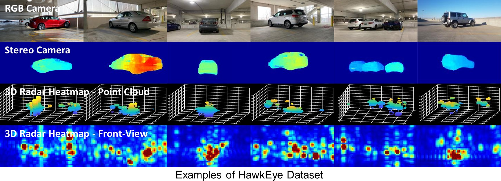

# RadarForge

Explore a multimodal millimeter-wave radar dataset and its MATLAB scene synthesizer: camera images, stereo depth, CAD geometry, radar point clouds, and radar heatmaps. RadarForge preserves the [HawkEye research source](#source-and-license) and adds a small signal-processing entry point, synthetic checks, and setup guidance.



*Retained [HawkEye dataset showcase](Dataset/documentation/dataset_showcase.JPG) from the original research source. These are source dataset examples, not newly generated or independently validated RadarForge results.*

## Try the signal-processing check

Open MATLAB in the repository folder and run this complete example:

```matlab
run('tests/smoke_test.m')
```

The check constructs a deterministic synthetic tone at one receiver, processes a **400 × 40 × 40** signal tensor, and verifies a **96 × 64 × 32** heatmap with the expected range peak. It uses base MATLAB and does not require a sensor or a learned model. [Verification and limits](docs/VERIFICATION.md).

## Process your signals

```matlab
heatmap = radar_forge(signal_array);
```

`signal_array` contains **fast-time samples × receiver x positions × receiver z positions**, with 400 × 40 × 40 samples under the bundled configuration. Fast time samples the signal within one frequency sweep. The output uses **range × azimuth angle × elevation angle** bins. The entry point forwards to the retained `radar_dsp` function and preserves its numerical output and errors.

Processing first applies a Fourier transform along fast time to separate ranges, then combines receiver signals with angle-dependent phase weights to estimate arrival directions. The output is squared signal magnitude, not a learned reconstruction.

## Explore the retained workflows

| Material | Start here |
| --- | --- |
| Dataset layout and capture conventions | [HawkEye dataset guide](Dataset/documentation/HawkEye_Dataset.pdf) |
| CAD models, placement, and synthesis | [Synthesizer guide](Synthesizer/documentation/HawkEye_Synthesizer.pdf) |
| Legacy CAD-to-heatmap implementation | [Synthesizer/scripts/main.m](Synthesizer/scripts/main.m) |
| Radar frequency, sampling, and array configuration | [`variable_library_radar.m`](Synthesizer/scripts/variable_library_radar.m) |

The CAD-to-radar workflow selects visible geometry, samples point reflectors, simulates receiver signals, and applies radar processing. It is separate from the base-MATLAB check above. Point sampling calls `datasample` from Statistics and Machine Learning Toolbox; signal simulation calls `awgn` from Communications Toolbox. Full synthesis and dataset-wide replication remain unverified here. Original script and function names remain available.

The repository contains the dataset and synthesizer, **not the HawkEye cGAN training implementation or a trained neural reconstruction model**.

## Source and license

Based on [HawkEye Dataset & Radar Data Synthesizer](https://github.com/JaydenG1019/HawkEye-Data-Code/tree/43d083789f1badca4b040fd8fc69de0e5c3c0f36) by **Junfeng Guan, Sohrab Madani, Suraj Jog, Saurabh Gupta and Haitham Hassanieh**. [Source and contribution details](NOTICE.md).

[Synthesizer/COPYRIGHT.txt](Synthesizer/COPYRIGHT.txt) retains the separate university notice. [LICENSE-branding](LICENSE-branding) covers only new documentation, artwork, wrapper, and checks. Existing dataset and asset notices remain in place. Computational source and bundled scientific assets are retained unchanged.
